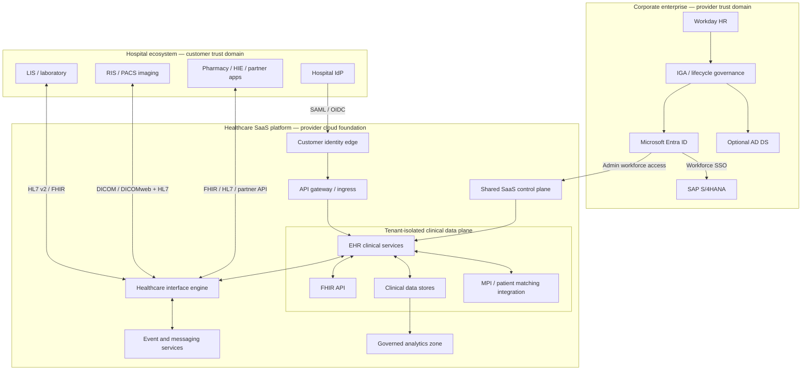

# End-to-End Healthcare Software Enterprise — Reference Architecture

> **Scenario status:** Entirely hypothetical and created for learning. It is not a description of any real healthcare vendor, hospital, customer environment or proprietary system.
>
> **Purpose:** Demonstrate how cloud foundations become the platform for a complete enterprise and healthcare SaaS product. This is a target-state architecture blueprint, not a deployable runbook or a compliance certification.

## 1. Executive summary

The reference organisation is a global healthcare software provider that develops and operates a multi-tenant Electronic Health Record (EHR) platform for hospitals. Its architecture contains two connected but separately governed domains:

1. **Corporate enterprise:** workforce, HR, finance, procurement, identity, IT service management and business operations.
2. **Healthcare product platform:** hospital tenant onboarding, clinician and patient access, EHR clinical services, healthcare interoperability, clinical data, analytics and customer support.

The design establishes cloud foundations before deploying workloads. It uses a shared SaaS control plane, a tenant-isolated clinical data plane, federated hospital identity, separate patient identity, standards-based healthcare interfaces, event-driven integration, security operations and a defined SRE / service-management model.

**Primary-cloud principle:** Select one primary cloud and one primary clinical data-plane pattern for the first production implementation. Azure, AWS, Google Cloud and OCI patterns are compared in this repository; they are not combined into a single multi-cloud clinical transaction path by default. Keep logical architecture, interfaces, controls and IaC modular so alternative provider implementations remain possible.

## 2. Business context and capabilities

### 2.1 Business capabilities

| Capability | What the enterprise must do |
|---|---|
| Corporate workforce | Hire, onboard, move and offboard employees and contractors |
| Finance and procurement | Manage general ledger, purchasing, suppliers, billing and financial reporting |
| Product engineering | Build, test, release and support the EHR product |
| Customer onboarding | Contract, provision, configure and support hospital tenants |
| Clinician experience | Authenticate hospital staff and provide role- and context-appropriate EHR access |
| Patient experience | Provide patient portal and mobile access with separate identity and recovery journeys |
| Clinical interoperability | Exchange orders, results, documents and imaging with hospital systems |
| Clinical data management | Protect, retain, audit, correct and govern clinical records |
| Analytics | Provide approved operational, quality and population-level insights |
| Service operations | Monitor, respond, recover, communicate and continuously improve the service |

### 2.2 System-of-record boundaries

Do not model the enterprise as one linear **Workday → Active Directory → SAP → EHR** process. These systems serve different business domains and exchange only the data required for an approved purpose.

| System / authority | Owns or governs | Does not become |
|---|---|---|
| Workday | Provider workforce HR attributes and employment lifecycle | Clinical patient record or universal identity authority |
| IGA platform / lifecycle workflow | Access requests, approvals, role governance, joiner-mover-leaver orchestration and certification | HR system of record |
| Microsoft Entra ID | Provider workforce cloud identity, SSO, conditional access and application access | Hospital's identity provider |
| Active Directory Domain Services (AD DS) | Legacy domain services where applications or endpoints still require them | Mandatory dependency for every cloud workload |
| SAP S/4HANA | ERP, finance, procurement and commercial transactions | Clinical system of record or routine PHI transport |
| Hospital identity provider | Authentication of hospital clinicians and staff | Provider employee identity |
| Patient CIAM | Patient / caregiver registration, authentication, recovery and consent-aware portal access | Workforce directory |
| EHR platform | Clinical workflows and records within the agreed product and customer data-governance contract | Corporate HR or ERP |
| Customer-approved MPI / patient identity authority | Patient identity matching and record-linking rules | A generic assumption that the SaaS provider owns every patient's identity |

## 3. Target architecture: planes and trust boundaries

### 3.1 Logical planes

| Plane | Responsibility | Main components |
|---|---|---|
| Corporate enterprise | Run the software provider | Workday, IGA, Entra ID, optional AD DS, SAP, ITSM, enterprise integration |
| Customer identity edge | Establish trust with hospitals and patients | Hospital SAML / OIDC federation, patient CIAM, tenant registry, API access policy |
| SaaS control plane | Provision and operate customer service instances | Tenant onboarding, entitlements, configuration, support tooling, release orchestration |
| Clinical data plane | Execute care-related workflows and persist records | EHR domain services, FHIR APIs, MPI integration, clinical databases, terminology services |
| Integration plane | Exchange clinical and enterprise messages | Healthcare interface engine, HL7 v2 adapters, FHIR APIs, DICOM / DICOMweb, event broker |
| Data and analytics plane | Governed secondary use and reporting | Data lake / warehouse, catalog, lineage, de-identification, quality and analytics services |
| Platform operations plane | Secure and operate the service | CI/CD, observability, SIEM, vulnerability management, backup, DR, SRE toolchain |

### 3.2 Architecture view

*The diagram is conceptual. Network, tenant isolation and service boundaries must be detailed for the chosen cloud and deployment tier.*

## 4. End-to-end business and clinical journeys

### 4.1 Provider employee joiner / mover / leaver

1. HR creates or updates the worker record in Workday.
2. The approved lifecycle integration sends the minimum required worker attributes to IGA.
3. IGA evaluates employment status, job role, manager approval, location and segregation-of-duties policy.
4. IGA provisions or changes workforce identities and entitlements in Entra ID; it updates AD DS only for approved legacy dependencies.
5. Entra ID provides workforce SSO and conditional access to approved corporate applications, engineering tools and support systems.
6. When employment ends, access is disabled or removed according to policy, sessions and credentials are revoked, privileged access is reviewed, and evidence is retained.

**Controls:** least privilege, separation of duties, privileged identity management, access certification, exception expiry, audit trails and reconciliation.

### 4.2 Clinician sign-in and patient-context access

1. A clinician opens the hospital's EHR entry point.
2. The EHR redirects authentication to the hospital-owned identity provider using an agreed SAML 2.0 or OIDC federation.
3. The identity assertion is validated; issuer, audience, signature, expiry, MFA posture and required attributes are checked.
4. The SaaS identity edge resolves the hospital tenant and maps the clinician to an approved role and organisation context.
5. Authorization evaluates role, tenant, purpose of use, care relationship, patient context and other approved policy attributes.
6. Every access to sensitive clinical data is logged with actor, tenant, patient/resource reference, action, timestamp and decision context.
7. Session expiry, step-up authentication, emergency access and break-glass workflows are explicitly governed and reviewed.

**Important:** Authentication proves identity; it does not by itself authorize access to a patient record. Tenant resolution and clinical authorization are separate checks.

### 4.3 Patient portal journey

1. Patient or caregiver enters through the portal or mobile application.
2. Patient CIAM performs registration, identity proofing as required, authentication and account recovery.
3. The platform links the authenticated account to the correct patient identity using customer-approved matching and verification rules.
4. Proxy / caregiver access is evaluated separately, including legal authority, scope and expiry.
5. The patient can view only the records and functions permitted by the customer's policy and applicable law.
6. Consent, access, correction requests and account recovery actions are recorded.

Patient CIAM is distinct from workforce identity and hospital clinician federation.

### 4.4 Laboratory order and result exchange

1. A clinician creates an order in the EHR.
2. The EHR creates a clinical order event with a stable identifier and sends it through the healthcare interface engine.
3. The engine validates message structure, patient and encounter references, routing, terminology and destination contract.
4. The hospital LIS receives the order using the agreed HL7 v2 message profile or FHIR workflow and returns an acknowledgement.
5. The laboratory processes the specimen and sends result messages with identifiers, status, units, reference ranges and provenance.
6. The interface engine validates, correlates, deduplicates and routes the result to the correct tenant and patient context.
7. The EHR updates the clinical record and makes the result available under clinical workflow and authorization rules.
8. Rejected, delayed or unmatched messages enter a monitored exception queue with replay and reconciliation controls.

**Reliability controls:** ACK / NACK handling, idempotency, message persistence, retry with backoff, dead-letter queue, correlation IDs, sequence handling, reconciliation and clinical exception ownership.

### 4.5 Imaging workflow

1. The EHR creates or receives an imaging order.
2. The integration plane exchanges order and scheduling context using the customer-agreed HL7 / FHIR interface.
3. The imaging system creates a study and stores images in PACS or an approved imaging repository.
4. Study metadata and identifiers are associated with the EHR encounter.
5. Authorized clinicians retrieve images using DICOM or DICOMweb through approved network and identity controls.
6. Access and retrieval are audited; image references and provenance remain traceable.

### 4.6 Corporate finance and commercial workflow

1. Workday supplies approved workforce or organisational attributes to finance processes where needed.
2. SAP remains the system of record for ERP, finance, procurement, supplier and billing transactions.
3. SAP exchanges commercial events with subscription, contract or customer-management services through governed APIs, events or enterprise integration.
4. Patient clinical payloads are not routed through SAP by default. Any exception requires explicit purpose, minimization, privacy and security approval.

## 5. Integration catalogue

| Source → target | Purpose | Preferred pattern | Key control |
|---|---|---|---|
| Workday → IGA / Entra | Workforce lifecycle attributes | API, supported connector or reconciled feed | HR ownership, minimum attributes |
| IGA / Entra → AD DS | Legacy account lifecycle | Scoped directory connector / sync | No blanket AD dependency |
| Entra → SAP / corporate apps | Workforce SSO and provisioning | SAML / OIDC, SCIM where supported | Role approval and certification |
| Workday ↔ SAP | Approved HR / finance attributes | SAP Integration Suite, API, event or batch | Field-level purpose and reconciliation |
| SAP → commercial services | Contract, invoice and subscription events | API / enterprise event | No patient clinical payload by default |
| Hospital IdP → EHR | Clinician authentication | SAML 2.0 / OIDC | Trust metadata, certificate rotation |
| EHR ↔ LIS | Orders, specimens, results and status | HL7 v2 and/or FHIR | ACK / NACK, idempotency |
| EHR ↔ RIS / PACS | Imaging orders and retrieval | HL7, DICOM / DICOMweb | Secure retrieval and provenance |
| EHR ↔ pharmacy / HIE / partner apps | Medication, referral and exchange | FHIR, HL7, SMART on FHIR, partner API | Approved scopes and partner contracts |
| EHR → analytics zone | Approved reporting and secondary use | Governed CDC, batch or event | Purpose approval, minimization, de-identification |

**Integration boundary:** Use SAP Integration Suite for SAP and enterprise A2A / B2B flows where approved. Keep clinical HL7 / FHIR / DICOM processing in a healthcare integration service or interface engine that understands patient, order and clinical message semantics. Do not make ERP middleware the default transport for patient-care transactions.

## 6. Data architecture, privacy and governance

### 6.1 Data domains and accountability

| Data domain | Authority / owner | Protection expectations |
|---|---|---|
| Patient identity and matching | Customer-designated identity authority / EHR data steward | Restricted identifiers, matching controls, correction workflow, access audit |
| Clinical records | Customer-defined controller / provider role and EHR product owner | Encryption, tenant isolation, fine-grained authorization, immutable audit |
| Imaging | Hospital imaging authority / PACS owner | DICOM provenance, access controls, retention and secure transfer |
| Workforce data | Workday / HR | Minimum attributes, purpose limitation and retention |
| Finance / procurement | SAP / Finance | ERP segregation, financial controls and audit |
| Product telemetry | Product / SRE with privacy oversight | Avoid PHI in logs; redact identifiers and control retention |
| Analytics / research | Data governance and approved data owner | Approved purpose, de-identification, lineage and access review |

### 6.2 Baseline controls

- Classify data before selecting storage, region, replication and retention.
- Encrypt data in transit and at rest; define key ownership, rotation, revocation and separation of duties.
- Keep production PHI out of routine non-production environments. Use synthetic or approved masked data.
- Enforce tenant isolation in identity, API authorization, data access, encryption boundaries, observability and backup/restore.
- Keep PHI out of URLs, routine application logs, traces, error messages and support tickets unless explicitly justified and protected.
- Maintain data lineage, retention schedules, legal holds, deletion / correction workflows and export controls.
- Define data residency and cross-border transfer requirements with legal, privacy and customer stakeholders.
- Treat analytics and research as separately approved purposes, not automatic reuse of operational clinical data.

## 7. Network and connectivity architecture

### 7.1 Network zones

1. **Edge / ingress:** DDoS protection, WAF, API gateway, rate limits, bot protection and controlled public entry.
2. **Shared platform services:** identity integration, DNS, private connectivity, secrets, logging, monitoring and management.
3. **Application zones:** web, API, integration, background processing and internal service tiers.
4. **Clinical data zones:** private data services, controlled administrative paths and tenant-aware access enforcement.
5. **Management / security zones:** SIEM, vulnerability tooling, backup administration, privileged access and incident response.
6. **Customer connectivity:** site-to-site VPN or private connectivity where justified, with explicit routing and segmentation.

### 7.2 Hybrid and hospital connectivity

- Use private connectivity only where the hospital use case, throughput, latency, availability and cost justify it; otherwise use hardened VPN / internet-facing APIs with strong controls.
- Avoid overlapping CIDR ranges through IPAM and customer onboarding validation.
- Define route ownership, BGP policy, DNS forwarding, certificate lifecycle, egress inspection and firewall change governance.
- Treat each hospital connection as a separate trust boundary; do not create broad transitive access between customer networks.
- Provide redundant connectivity paths and test failover, not just link status.
- Publish supported connectivity patterns and customer prerequisites.

## 8. Security architecture

### 8.1 Identity and privileged access

- Federate workforce identity; use MFA and conditional access.
- Use JIT / JEA privileged access, approval and session recording where appropriate.
- Prefer managed identities / workload identities over static secrets.
- Separate human, service, emergency and automation identities.
- Store secrets and keys in managed vault / KMS services with rotation and access audit.
- Use break-glass identities with offline protection, alerting and periodic tests.

### 8.2 Platform and workload protection

- Apply organization policy / SCP / organization policy / compartment policy according to provider.
- Centralize cloud audit logs and security findings in protected security accounts / projects / subscriptions / compartments.
- Scan images, dependencies, IaC and secrets in CI/CD.
- Enforce signed artifacts, provenance, approved registries and deployment policy.
- Use network segmentation, private service access, WAF, egress control and service-to-service authentication.
- Patch operating systems, containers, managed runtimes and dependencies under defined SLAs.
- Maintain vulnerability exceptions with owner, rationale, expiry and compensating controls.

### 8.3 Healthcare-specific security and safety

- Separate clinical safety hazard analysis from generic cyber risk assessment.
- Validate patient matching, order/result correlation, terminology and clinical workflow behavior with clinical stakeholders.
- Ensure emergency access is possible but tightly audited and reviewed.
- Test downtime procedures and clinical continuity with hospitals.
- Define incident notification responsibilities in customer contracts and applicable jurisdictional requirements.
- Do not claim HIPAA, DPDP or any other compliance solely because a cloud provider offers eligible services. Compliance depends on the full service, contracts, configuration, operating controls and evidence.

## 9. Application and platform architecture

### 9.1 Application components

- Web clinician workspace and patient portal / mobile clients.
- API gateway and identity-aware application edge.
- EHR domain services for encounters, orders, results, medication, documents and workflows.
- FHIR API layer with explicit version and implementation-guide support.
- Tenant registry, configuration service and entitlement service.
- Healthcare interface engine and partner adapter layer.
- Event broker / durable messaging and workflow orchestration.
- Clinical databases, document / object storage and imaging references.
- Search, terminology and patient matching integration.
- Analytics ingestion and governed data products.

### 9.2 Multi-tenancy model

Use a risk-based isolation tier rather than assuming one tenancy pattern fits every hospital.

| Tier | Pattern | Use when |
|---|---|---|
| Shared | Shared application runtime with strong tenant-aware authorization and logical data partitioning | Lower-risk workloads with validated isolation controls |
| Pooled with dedicated data boundary | Shared control plane / selected services, dedicated database or encryption boundary | Stronger customer isolation or performance needs |
| Silo | Dedicated workload stack and data stores per customer / regulated boundary | Contract, jurisdiction, scale or risk requires stronger isolation |

For every tier, test cross-tenant access, cache keys, search indexes, background jobs, exports, backups, support access and analytics pipelines. Tenant isolation must be demonstrated across the complete data lifecycle.

### 9.3 Resilience and scalability

- Design stateless application tiers for horizontal scaling.
- Use queues and event-driven decoupling for variable hospital interface traffic.
- Apply back-pressure, bounded retries, circuit breakers and bulkheads.
- Use database replication and recovery patterns supported by the selected data service.
- Define service-level objectives per critical capability, not one generic availability number.
- Test capacity, peak clinical load, failover, restore and dependency failure.
- Ensure clinical workflows degrade safely and provide documented downtime procedures.

## 10. Cloud foundation implementation mapping

The same logical control domains are implemented using each provider's hierarchy and services. Select one provider for the initial production baseline and validate current product guidance.

| Foundation domain | Azure | AWS | Google Cloud | OCI |
|---|---|---|---|---|
| Adoption guidance | CAF | AWS CAF | Google Cloud adoption guidance | OCI CAF |
| Landing-zone structure | Management groups / subscriptions, Azure Landing Zones | Organizations / OUs / accounts, Control Tower | Organization / folders / projects, Enterprise Foundations | Tenancy / compartments, Core Landing Zone |
| Accelerator / IaC | ALZ accelerators / reviewed Terraform | LZA using CDK alongside Control Tower | Foundation Fabric FAST using Terraform | OCI Core Landing Zone modules / Terraform |
| Identity | Entra ID, Azure RBAC, PIM | IAM Identity Center, IAM roles, SCPs | Cloud Identity / IAM, organization policies | IAM domains, groups, policies |
| Network | Hub-spoke / Virtual WAN, Firewall, Private Link | VPC, Transit Gateway, Network Firewall, endpoints | Shared VPC, Cloud Router, Cloud NAT, VPC Service Controls where appropriate | VCN, DRG, gateways, FastConnect |
| Security / audit | Azure Policy, Defender, Key Vault, Monitor | CloudTrail, Config, Security Hub, GuardDuty, KMS | Cloud Audit Logs, Security Command Center, Cloud KMS | Audit, Cloud Guard, Vault, Security Zones |
| Operations | Azure Monitor, backup, automation | CloudWatch, Backup, Systems Manager | Cloud Monitoring, Logging, Backup and DR services | Monitoring, Logging, Cloud Guard and recovery services |

### 10.1 Azure baseline

- Establish Entra tenant, management-group hierarchy and subscription strategy.
- Separate platform services such as identity, connectivity, management and security.
- Create workload landing zones for EHR, integration, analytics and corporate workloads.
- Apply Azure Policy, RBAC, centralized logging, Defender posture, DNS, firewall, private access and cost allocation.
- Deploy using pinned, reviewed IaC modules with protected state and staged policy rollout.

### 10.2 AWS baseline

- Establish AWS Organizations and OUs for security, infrastructure, sandbox and workloads.
- Use Control Tower for the governed multi-account baseline and account provisioning.
- Add Landing Zone Accelerator where additional security, networking and compliance-oriented configuration is required.
- Centralize log archive and security audit, use SCPs and detective controls, and design network accounts / transit deliberately.
- Maintain the LZA configuration and CDK pipeline as controlled platform code.

### 10.3 Google Cloud baseline

- Establish organization, folders and projects around security, environment and workload boundaries.
- Use Enterprise Foundations Blueprint for secure foundational capabilities.
- Use Foundation Fabric FAST stages selectively: organization bootstrap, optional VPC Service Controls, shared resources and application / operations foundations.
- Apply Organization Policy, IAM, Shared VPC, centralized security and Terraform factory patterns.
- Protect state, pin versions, validate policy and detect drift.

### 10.4 OCI baseline

- Establish tenancy compartments for platform, security, network, shared services, workloads and environments.
- Apply compartment IAM policies and separation of duties.
- Design VCNs, DRGs, route tables, gateways, private access, egress and FastConnect / VPN paths.
- Apply Cloud Guard, Security Zones where suitable, Audit, Vault and centralized monitoring.
- Deploy modular Core Landing Zone infrastructure as code and validate against current OCI guidance.

## 11. DevSecOps and infrastructure automation

### 11.1 Delivery flow

```mermaid
flowchart LR
  A["Architecture / ADR"] --> B["Git commit / pull request"]
  B --> C["Lint + unit tests"]
  C --> D["SAST / dependency / secret scan"]
  D --> E["Terraform validate + plan"]
  E --> F["Policy as code"]
  F --> G["Approval / change control"]
  G --> H["Deploy to non-production"]
  H --> I["Integration / security / performance tests"]
  I --> J["Production approval"]
  J --> K["Progressive deployment"]
  K --> L["Observe / verify / rollback"]
```

### 11.2 IaC controls

- Separate platform foundation modules from workload modules.
- Use remote state with encryption, locking, restricted access and recovery.
- Pin provider and module versions; review upgrades.
- Use short-lived CI identities and least-privilege deployment roles.
- Require peer review and environment promotion.
- Add policy-as-code checks for public exposure, encryption, region, tags, logging and network rules.
- Detect drift and reconcile through approved change workflows.
- Keep secrets out of state and source control wherever possible.

## 12. Operations, SRE and service management

### 12.1 Operational responsibilities

| Function | Responsibilities |
|---|---|
| Cloud platform team | Landing zones, shared services, policy, network, account / subscription / project governance |
| Product engineering | Application reliability, release quality, defect remediation and technical ownership |
| SRE / operations | SLOs, observability, on-call, incident response, capacity, recovery and toil reduction |
| Security operations | Detection, triage, threat hunting, vulnerability and incident coordination |
| Clinical informatics / safety | Clinical workflow validation, hazards, downtime and safe release acceptance |
| Data governance / privacy | Data classification, retention, lineage, access purpose and privacy review |
| Customer integration | Hospital connectivity, interface onboarding, message monitoring and partner coordination |
| Service management | Change, problem, service request, customer communication and service reporting |
| FinOps | Allocation, budgets, anomaly detection, unit economics and optimization |

### 12.2 Observability

Collect platform, application, integration and security telemetry with correlation IDs and tenant context. Avoid logging PHI by default. Monitor:

- User-facing latency, availability and error rates.
- Authentication and authorization failures.
- Per-tenant resource consumption and noisy-neighbor signals.
- HL7 / FHIR message volume, ACK latency, NACKs, retries and queue age.
- Imaging transfer and retrieval performance.
- Database health, replication lag, backup status and restore tests.
- Security findings, privileged activity and policy violations.
- Cost per tenant, encounter or agreed business unit where measurable.

### 12.3 Incident and change management

Define severity, clinical impact assessment, on-call ownership, customer communications, incident command, evidence preservation, post-incident review and corrective action. Clinical-impacting changes require clinical validation, customer coordination where contracted, rollback plans and explicit release approval.

## 13. Availability, backup and disaster recovery

Set SLO, RTO and RPO from business impact analysis, clinical criticality, customer contracts, legal obligations and technical feasibility. Do not invent universal targets.

- Define service tiers for identity, EHR transactions, interface engine, patient portal, analytics and administrative systems.
- Identify dependencies and recovery order.
- Use immutable or protected backups and separate backup administration.
- Test point-in-time recovery, data integrity, key recovery and application consistency.
- Design region / zone failure handling and cross-region recovery only where supported and justified.
- Test hospital connectivity restoration, DNS failover, certificate availability and partner reconnection.
- Run tabletop exercises and technical failover tests; retain evidence and remediation actions.
- Document clinical downtime, reconciliation and safe return-to-service procedures.

## 14. FinOps and unit economics

- Apply consistent ownership, environment, application, tenant and cost-center tags / labels.
- Allocate shared platform costs using a transparent model.
- Monitor budgets, anomalies, commitments, storage growth, data transfer, logging and backup costs.
- Measure unit economics such as cost per tenant, active clinician, encounter or interface message where data quality supports it.
- Review non-production schedules, autoscaling, storage lifecycle and idle resources.
- Include DR, security, observability and data egress in total cost of ownership.
- Do not optimize cost in ways that weaken clinical safety, security or recovery objectives.

## 15. TOGAF ADM and ArchiMate governance

Use TOGAF Standard 10th Edition as an architecture method, tailored to the organisation's governance. Use ArchiMate-aligned views to connect strategy, business capabilities, applications, data and technology. Complement these with C4 context/container/component diagrams, sequence diagrams, deployment views and network diagrams.

| ADM phase | Application in this programme | Key artefacts |
|---|---|---|
| Preliminary | Establish principles, architecture capability, governance and tailoring | Principles, roles, repository structure |
| A — Architecture Vision | Agree business outcomes, scope, stakeholders and constraints | Vision, scope, capability map, stakeholder map |
| B — Business Architecture | Model provider business and clinical SaaS capabilities | Capability map, value streams, business process views |
| C — Information Systems Architecture | Define applications, data, identity and integration | Application portfolio, data domains, interface catalogue |
| D — Technology Architecture | Define cloud foundations, network, security and runtime | Landing-zone design, network, platform and deployment views |
| E — Opportunities & Solutions | Group work packages and transition architectures | Solution building blocks, work packages |
| F — Migration Planning | Sequence foundation, pilot, migration and rollout | Roadmap, dependencies, costs and risks |
| G — Implementation Governance | Review designs, exceptions, delivery and evidence | Architecture decisions, compliance assessments |
| H — Architecture Change Management | Govern new requirements, cloud changes and technical debt | Change requests, standards updates, risk review |
| Requirements Management | Trace requirements through all phases | Requirement catalogue and traceability matrix |

### 15.1 Initial architecture decision records

| ADR | Baseline decision | Revisit when |
|---|---|---|
| 001 | Workday is workforce HR source of record | HR operating model changes |
| 002 | IGA or approved lifecycle workflow orchestrates JML | Tooling, licensing or control model changes |
| 003 | Entra ID is provider workforce cloud identity; AD DS is optional for legacy | Enterprise identity standard changes |
| 004 | Hospital clinicians authenticate through customer-owned IdP federation | Customer contract defines a different model |
| 005 | Patient portal identity uses separate CIAM | Patient proofing / legal requirements change |
| 006 | EHR owns clinical workflows in the agreed product scope, subject to customer data roles | Controller / processor contract changes |
| 007 | FHIR is the modern API baseline; HL7 v2 and DICOM adapters support installed integrations | Customer profiles or standards change |
| 008 | Clinical messages use a dedicated healthcare integration plane | Validated integration architecture changes |
| 009 | SAP owns ERP and finance; no routine PHI dependency is assumed | Approved business requirement exists |
| 010 | Shared control plane with risk-based tenant-isolated clinical data plane | Customer risk / scale requires another tier |
| 011 | One primary cloud for each clinical production deployment | A funded multi-cloud use case is approved |
| 012 | Cloud-native FHIR service is selected only after profile, region, security and exit validation | Provider capabilities or requirements change |
| 013 | RTO / RPO / SLO derive from BIA and approved contract tier | Business impact or contract changes |
| 014 | No production PHI in routine non-production | A documented, approved exception is granted |

## 16. Delivery roadmap

| Stage | Work | Exit evidence |
|---|---|---|
| 0. Discovery | Business goals, jurisdiction, customer contracts, data classification, BIA and architecture principles | Approved scope, risks and requirements |
| 1. Cloud foundation | Organization hierarchy, identity, network, security, logging, policy, IaC and FinOps | Landing-zone control evidence and platform acceptance |
| 2. Shared SaaS platform | CI/CD, container / runtime platform, secrets, observability, tenant registry and support access | Secure platform baseline and operational ownership |
| 3. Clinical product pilot | EHR core, FHIR API, tenant isolation, clinician federation and patient identity | Functional, security, privacy and clinical validation |
| 4. Hospital integration pilot | One representative hospital, LIS and imaging integration, message monitoring and reconciliation | End-to-end interface test evidence and customer sign-off |
| 5. Resilience and operations | Backup, restore, DR, SLOs, on-call, incident and downtime exercises | Recovery test reports and operational readiness |
| 6. Production rollout | Capacity, penetration testing, release governance, customer acceptance and go-live | Signed production go/no-go and rollback plan |
| 7. Scale and optimize | More tenants, automation, unit economics, platform improvements and provider portability | Service reviews, cost controls and architecture updates |

## 17. Production readiness gates

### Architecture and governance
- [ ] Business, data, application and technology views reviewed.
- [ ] Primary cloud, region, tenant model and workload boundaries approved.
- [ ] ADRs have owners, status, alternatives and approval evidence.
- [ ] Customer contracts, data roles and jurisdictional obligations reviewed.

### Identity and security
- [ ] Workforce, hospital clinician, patient and workload identities are separated.
- [ ] MFA, least privilege, privileged access and break-glass are tested.
- [ ] Tenant authorization and cross-tenant isolation tests pass.
- [ ] Encryption, key management, secrets, vulnerability and incident controls are evidenced.

### Clinical and integration
- [ ] FHIR version, profiles and implementation guides agreed.
- [ ] HL7 v2 message types, ACK / NACK and exception workflows tested.
- [ ] DICOM / DICOMweb retrieval and provenance validated.
- [ ] Patient matching, terminology and clinical workflow behavior signed off.
- [ ] Downtime and reconciliation procedures exercised.

### Platform and operations
- [ ] Infrastructure is versioned, reviewed and deployed through controlled pipelines.
- [ ] Logs, metrics, traces, alerting and on-call ownership are active.
- [ ] Backup restore and DR tests meet approved RTO / RPO.
- [ ] Capacity, performance, failover and dependency failure tests pass.
- [ ] FinOps allocation, budgets and anomaly alerts are configured.
- [ ] Runbooks, customer communication and rollback plans are approved.

**Go-live rule:** A checklist is not evidence by itself. Each gate needs an owner, test result, artifact or explicit accepted exception.

## 18. Open decisions for a real implementation

The following must be resolved before detailed build or production deployment:

1. Which cloud provider and region are primary for the first production deployment?
2. Which countries and customer jurisdictions are in scope?
3. What are the data-controller / processor roles and contractual obligations?
4. What tenant isolation tier is required for each customer segment?
5. Which FHIR release, profiles, terminology services and HL7 v2 message sets are required?
6. Which hospital identity protocols and attributes are supported?
7. Which interface engine and partner connectivity patterns are approved?
8. What are the BIA-backed SLO, RTO and RPO values?
9. Which clinical safety hazards, validation requirements and downtime procedures apply?
10. What are the capacity, performance, data residency, retention and exit requirements?

## 19. Architecture conclusion

The architecture connects the provider's corporate systems and its healthcare SaaS product without collapsing their trust boundaries. Workday drives workforce lifecycle; IGA governs access; Entra ID and optional AD DS support provider workforce access; SAP owns ERP and finance; hospital identity providers authenticate clinicians; patient CIAM serves patient journeys; and the EHR processes clinical workflows through FHIR, HL7 and DICOM interfaces.

TOGAF ADM provides the governance method, ArchiMate provides structured architecture views, and the selected cloud foundation framework provides provider-specific guardrails. Production readiness is reached only after the organisation validates the customer, jurisdiction, clinical workflow, tenant model, security, capacity, recovery and operational evidence.

## 20. Further reading

- [Cloud Foundations Masterclass — repository home](../README.md)
- [Microsoft Cloud Adoption Framework](https://learn.microsoft.com/azure/cloud-adoption-framework/)
- [Azure Landing Zones](https://learn.microsoft.com/azure/cloud-adoption-framework/ready/landing-zone/)
- [AWS Cloud Adoption Framework](https://aws.amazon.com/cloud-adoption-framework/)
- [AWS Control Tower](https://docs.aws.amazon.com/controltower/)
- [Landing Zone Accelerator on AWS](https://aws.amazon.com/solutions/implementations/landing-zone-accelerator-on-aws/)
- [Google Cloud Enterprise Foundations](https://cloud.google.com/architecture/blueprints/security-foundations)
- [Cloud Foundation Fabric FAST](https://github.com/GoogleCloudPlatform/cloud-foundation-fabric)
- [OCI Cloud Adoption Framework](https://docs.oracle.com/en-us/iaas/Content/cloud-adoption-framework/home.htm)
- [OCI Landing Zones](https://docs.oracle.com/en/solutions/oci-landing-zones/)
- [HL7 FHIR](https://www.hl7.org/fhir/)
- [DICOM Standard](https://www.dicomstandard.org/)
- [TOGAF Standard](https://www.opengroup.org/togaf)
